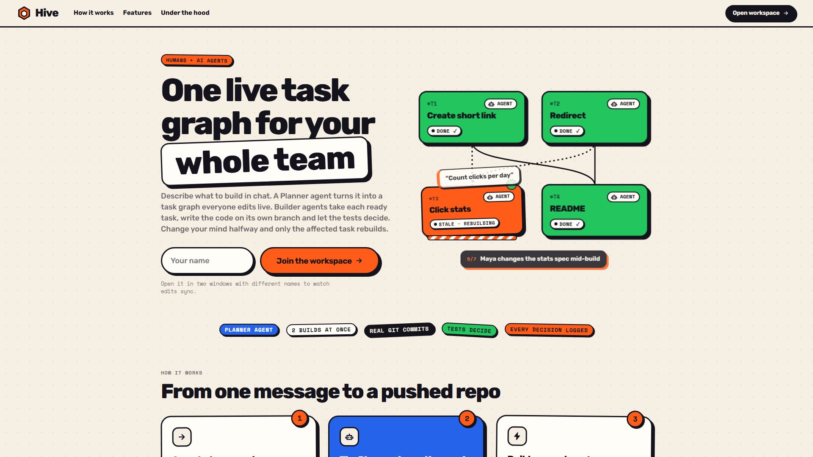
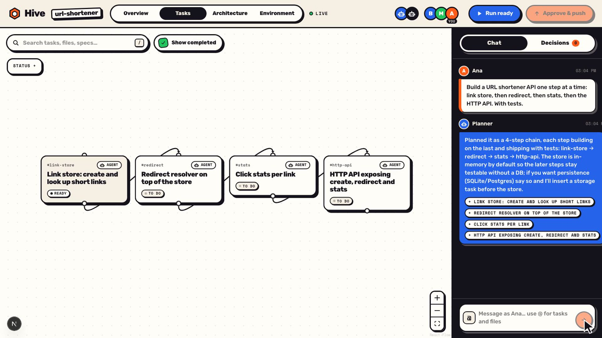
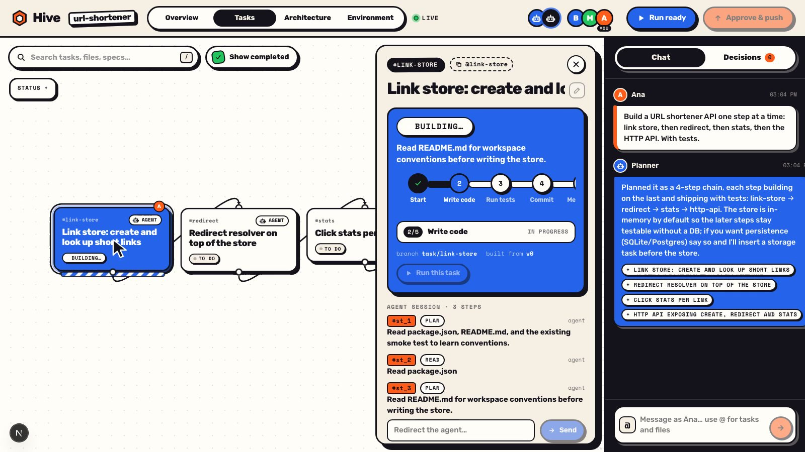
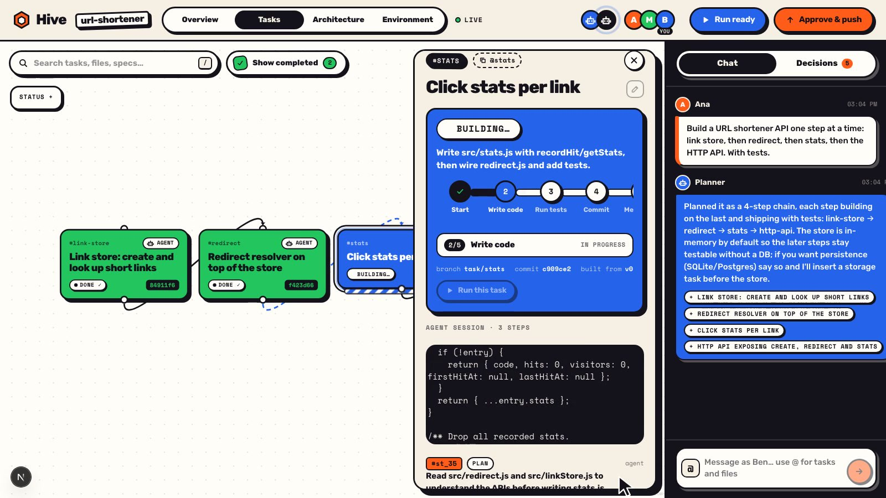
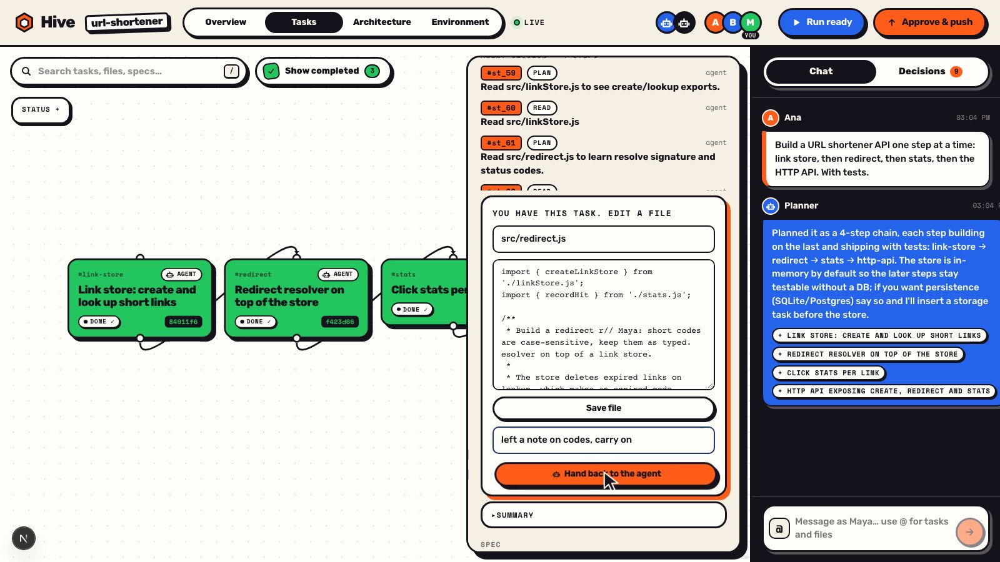

# Hive

**Google Docs for coding agents.** Your team shares one live task graph. Every agent session is visible to everyone, and anyone can watch an agent work, redirect it mid-run, take over a task and hand it back (or pass it to a teammate) with full context.



## How it works

1. **Plan together.** Describe what to build in chat. The Planner agent turns it into a task graph that shows up on every screen and that anyone can edit.
2. **Agents build in parallel.** Builder agents pick up every task whose dependencies are done. Each one works on its own git branch, and everyone sees its steps stream live: the plan, the file it is writing, tests going red then green.
3. **Steer, take over, hand back.** Type into any running session to change its course. Take over a task, edit a file yourself, then hand it back and the agent continues from your edit. Or reassign it to a teammate, who gets an auto-written summary.
4. **Ask what happened.** Ask the chat "what happened on stats?" and get an answer that cites the exact steps.
5. **Approve and push.** Every task is reviewed and merged into `main` once its tests pass. Approve runs the tests on `main` and pushes to GitHub, with commits from both agents and people.

## Screenshots

**The Planner turns one message into a task graph**



**Watch an agent's session live**



**See the code as the agent writes it**



**Take over a task, edit a file, hand it back**



## Stack

| Layer | Tech |
|---|---|
| Web app | [Next.js 16](https://nextjs.org) (client-only SPA), React 19, [React Flow](https://reactflow.dev) (`@xyflow/react`) for the graph |
| Realtime sync | [Yjs](https://yjs.dev) CRDT, one doc per project, synced by [Hocuspocus](https://tiptap.dev/hocuspocus) v4 over websockets |
| Server | Node + TypeScript (run with `tsx`), Express 5 |
| Agents | Native tool calls (read/write/edit files, search, run tests, run the CLI, install packages, screenshot) via any OpenAI-compatible provider (default: DeepSeek V4.1 Flash on Luminal) or Anthropic Claude. A scripted `fake` provider runs everything with no API key |
| Code and tests | Real git: one worktree and branch per task, merged into `main` under a repo lock. Tests run with `node --test` |
| Previews | Headless local Chrome/Edge screenshots the built app for the goal check |
| Auth and storage | [Supabase](https://supabase.com): GitHub sign-in, project list, Y.Doc snapshots, transcripts and history. Without it, everything is plain files under `data/` |
| GitHub | Each project gets its own private repo; Approve pushes `main` there |
| Hosting | Railway (`server/Dockerfile`) with a volume for workspaces |
| Tooling | pnpm workspaces, TypeScript, Vitest |

## Repo layout

```
shared/   @hive/shared: types.ts (the data contract) and the graph layout
server/   Express + Hocuspocus on :4000: agents, sessions, git, planner, reviewer, auth
web/      Next.js app on :5173
scripts/  reset.mjs (delete every project)
video/    the demo video, rendered from code
```

See [AGENTS.md](AGENTS.md) for the architecture and endpoints, and [INTEGRATION.md](INTEGRATION.md) for how the web app talks to the server.

## Run it

```bash
pnpm i
```

```bash
cp .env.example .env
```

Set `LLM_PROVIDER=fake` in `.env` to try it with scripted agents and no API key, or fill in `LLM_BASE_URL` / `LLM_API_KEY` (or `LLM_PROVIDER=anthropic` with `ANTHROPIC_API_KEY`) for real agents.

```bash
pnpm dev
```

Open http://localhost:5173. Open it in a second window (or on a second laptop on the same network) under another name to see edits sync live.

Other commands:

```bash
pnpm test
```

```bash
pnpm --filter server smoke
```

```bash
pnpm reset
```

`smoke` runs the whole demo end to end against the fake provider; `reset` deletes every project so the next start is empty.
